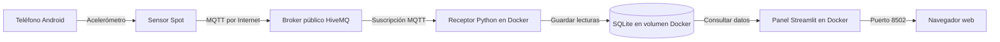

# SysDespacho-IA

Proyecto académico desarrollado en Python para las Tareas Académicas
del curso Herramientas de Desarrollo Profesional - TIC.
## Descripción

SysDespacho-IA implementa un asistente llamado DespachoBot para
clasificar, registrar y notificar despachos de contenedores.

El proyecto aplica los temas de las Semanas 06 y 07: chatbot con IA,
Streamlit, transcripción de audio, asistentes, Function Calling,
argumentos JSON y automatización de tareas externas.

## Estados de despacho

- `A_TIEMPO`: faltan más de 30 minutos.
- `PROXIMO`: faltan entre 0 y 30 minutos.
- `RETRASADO`: la hora programada ya pasó.

## Funcionalidades

- Chatbot mediante la API de Groq.
- Modelo `openai/gpt-oss-20b`.
- Interfaz desarrollada con Streamlit.
- Historial de conversación mediante `st.session_state`.
- Consultas mediante texto.
- Carga de archivos de audio.
- Grabación directa mediante micrófono.
- Transcripción mediante Whisper.
- Clasificación automática de despachos.
- Function Calling con argumentos JSON.
- Registro de despachos en Google Sheets.
- Notificaciones mediante Gmail.
- Notificaciones mediante WhatsApp y WAHA.
- Proceso completo automatizado:
  - clasificar;
  - registrar en Google Sheets;
  - enviar correo;
  - enviar WhatsApp.
- Pruebas automatizadas con Pytest.

## Herramientas disponibles

DespachoBot puede ejecutar las siguientes funciones:

- `clasificar_despacho`
- `registrar_despacho`
- `enviar_alerta_correo`
- `enviar_alerta_whatsapp`
- `procesar_despacho_completo`

Las herramientas que modifican información o envían mensajes solo
deben ejecutarse cuando el usuario lo solicite expresamente.

## Estructura principal

```text
SysDespacho-IA/
├── streamlit_app.py
├── app_consola.py
├── app_asistente.py
├── app_audio.py
├── funciones.py
├── herramientas.py
├── automatizacion.py
├── transcripcion.py
├── google_sheets.py
├── correo.py
├── whatsapp.py
├── tests/
│   ├── test_funciones.py
│   └── test_herramientas.py
├── requirements.txt
├── .env.example
└── README.md
```

## Requisitos

- Python 3.11 o superior.
- Cuenta y clave API de Groq.
- Proyecto de Google Cloud con Google Sheets API.
- Cuenta de servicio de Google.
- Cuenta de Gmail con contraseña de aplicación.
- Docker Desktop.
- WAHA ejecutándose mediante Docker.
- Cuenta de WhatsApp de prueba o autorizada.

## Instalación

Crear y activar el entorno virtual:

```powershell
python -m venv .venv
.\.venv\Scripts\Activate.ps1
```

Instalar las dependencias:

```powershell
python -m pip install -r requirements.txt
```

## Variables de entorno

Crear un archivo `.env` tomando como referencia `.env.example`.

Las variables principales son:

- `GROQ_API_KEY`
- `GROQ_MODEL`
- `GROQ_AUDIO_MODEL`
- `GOOGLE_CREDENTIALS_FILE`
- `GOOGLE_SHEET_ID`
- `GOOGLE_WORKSHEET`
- `SMTP_HOST`
- `SMTP_PORT`
- `SMTP_USER`
- `SMTP_APP_PASSWORD`
- `ALERT_EMAIL_TO`
- `WAHA_URL`
- `WAHA_API_KEY`
- `WAHA_SESSION`
- `WHATSAPP_TO`

## Ejecución de la interfaz

Primero debe estar iniciado Docker Desktop y el contenedor de WAHA.

Para iniciar nuevamente un contenedor WAHA existente:

```powershell
docker start waha
```

Después, ejecutar la aplicación:

```powershell
python -m streamlit run .\streamlit_app.py
```

## Ejecución por consola

Chatbot básico:

```powershell
python .\app_consola.py
```

Asistente con herramientas:

```powershell
python .\app_asistente.py
```

## Pruebas automatizadas

Ejecutar:

```powershell
python -m pytest -v
```

El proyecto contiene pruebas para:

- estado `A_TIEMPO`;
- estado `PROXIMO`;
- límite de cero minutos;
- estado `RETRASADO`;
- procesamiento de argumentos JSON;
- control de herramientas inexistentes.

## Flujo automatizado

```text
Usuario
   ↓
DespachoBot
   ↓
Function Calling
   ↓
Clasificación del despacho
   ↓
Google Sheets + correo + WhatsApp
   ↓
Respuesta final al usuario
```

## Seguridad

Los siguientes archivos y directorios no deben subirse al repositorio:

- `.env`
- `service_account.json`
- `waha/.env`
- `waha/sessions/`
- entornos virtuales;
- archivos temporales de Python.

Estos elementos están excluidos mediante `.gitignore`.

No deben escribirse claves, contraseñas ni números personales
directamente dentro del código fuente.

## Relación con la Semana 06

El proyecto incluye:

- chatbot con modelo de IA;
- uso de una API;
- desarrollo en Python;
- interfaz con Streamlit;
- historial de conversación;
- carga y grabación de audio;
- transcripción mediante Whisper.

## Relación con la Semana 07

El proyecto incluye:

- asistente con instrucciones especializadas;
- mensajes e historial;
- ejecución de herramientas;
- Function Calling;
- argumentos JSON;
- Google Sheets;
- correo automático;
- WhatsApp mediante WAHA;
- automatización completa de un proceso.


## Tarea Académica 3: monitoreo IoT

### Caso de uso

La solución IoT permite monitorear el movimiento de un contenedor durante
su proceso de despacho. Un teléfono Android funciona como nodo IoT y utiliza
su acelerómetro para capturar valores en los ejes X, Y y Z.

Las lecturas permiten clasificar la condición del contenedor como:

- `NORMAL`: no se detecta una variación importante.
- `MOVIMIENTO`: se detecta movimiento moderado.
- `IMPACTO`: se detecta una variación fuerte que podría representar un golpe.

Los límites utilizados son académicos y sirven para demostrar el
funcionamiento de la solución. No representan una calibración industrial.

### Cumplimiento de los requisitos

1. **Captura:** Sensor Spot obtiene las lecturas del acelerómetro del teléfono.
2. **Transmisión:** las lecturas se envían en formato JSON mediante MQTT.
3. **Recepción:** un servicio Python recibe los mensajes con Paho MQTT.
4. **Almacenamiento:** las lecturas se guardan en una base SQLite persistente.
5. **Contenedores:** Docker Compose ejecuta el receptor y el panel.
6. **Visualización:** Streamlit presenta métricas, alertas, gráficos e historial.

### Arquitectura



El teléfono y la computadora pueden utilizar redes diferentes porque ambos
se conectan al broker MQTT mediante Internet.

### Formato de los datos

Sensor Spot envía lecturas JSON similares a la siguiente:

```json
{
  "type": "android.sensor.accelerometer",
  "values": [-0.08, -0.14, 9.72],
  "timestamp": 2506584219235611
}
```

El broker MQTT transporta los mensajes, pero no funciona como base de datos.
El almacenamiento permanente se realiza en SQLite.

### Componentes IoT

```text
iot_backend/
├── __init__.py
├── clasificacion.py
├── almacenamiento.py
└── receptor_mqtt.py

iot_frontend/
├── __init__.py
└── dashboard.py

tests/
└── test_iot.py

Dockerfile.iot
docker-compose.iot.yml
.dockerignore
```

- `clasificacion.py`: calcula la magnitud y clasifica el movimiento.
- `almacenamiento.py`: crea la tabla y guarda las lecturas en SQLite.
- `receptor_mqtt.py`: se suscribe al topic MQTT y procesa cada mensaje.
- `dashboard.py`: muestra las métricas, alertas, gráficos e historial.
- `test_iot.py`: valida la clasificación y el almacenamiento.
- `Dockerfile.iot`: construye la imagen Python de la plataforma.
- `docker-compose.iot.yml`: ejecuta el receptor y el panel en contenedores.

### Configuración de Sensor Spot

- Broker: `broker.hivemq.com`
- Puerto: `1883`
- Topic: `sysdespacho/frankarone/ta3/acelerometro`
- QoS: `0`
- Sensor: acelerómetro
- Frecuencia configurada: `1000000`
- WebSocket: desactivado
- SSL: desactivado para esta demostración académica

### Ejecución con Docker

Construir e iniciar la plataforma:

```powershell
docker compose -f .\docker-compose.iot.yml up --build -d
```

Verificar los contenedores:

```powershell
docker compose -f .\docker-compose.iot.yml ps
```

Consultar los mensajes del receptor:

```powershell
docker compose -f .\docker-compose.iot.yml logs -f receptor-iot
```

Abrir el panel:

```text
http://localhost:8502
```

Detener los servicios sin eliminar los datos:

```powershell
docker compose -f .\docker-compose.iot.yml stop
```

Volver a iniciarlos:

```powershell
docker compose -f .\docker-compose.iot.yml start
```

Las lecturas se conservan en el volumen Docker `datos_iot`.

### Razones técnicas

- **MQTT** se eligió porque es un protocolo ligero y adecuado para transmitir
  datos de sensores.
- **Sensor Spot** permite utilizar el acelerómetro del teléfono sin desarrollar
  una aplicación Android desde cero.
- **Python y Paho MQTT** permiten recibir y procesar fácilmente los mensajes.
- **SQLite** es suficiente para una demostración académica y no requiere un
  servidor de base de datos adicional.
- **Docker Compose** permite desplegar el receptor, el panel y el almacenamiento
  persistente de manera reproducible.
- **Streamlit** permite construir rápidamente un panel con métricas, gráficos
  e historial.

### Limitaciones y restricciones

- El broker utilizado es público y compartido; por ello no deben transmitirse
  datos personales, credenciales ni información confidencial.
- La conexión por el puerto `1883` no está cifrada. En un entorno real se debe
  emplear un broker privado con autenticación y TLS.
- La disponibilidad depende de la conexión a Internet del teléfono y de la
  computadora.
- Sensor Spot debe permanecer abierto en primer plano durante la demostración.
- Los límites de `NORMAL`, `MOVIMIENTO` e `IMPACTO` son valores académicos y
  requieren calibración antes de un uso real.
- SQLite es apropiado para esta prueba, pero una solución con muchos
  dispositivos necesitaría una base de datos de mayor capacidad.
- El broker MQTT transporta los mensajes, pero no reemplaza el almacenamiento.

### Pruebas y CI/CD

El proyecto contiene diez pruebas automatizadas:

- seis pruebas de la funcionalidad del asistente;
- tres pruebas de clasificación IoT;
- una prueba de almacenamiento SQLite.

Ejecutar las pruebas:

```powershell
python -m pytest -v