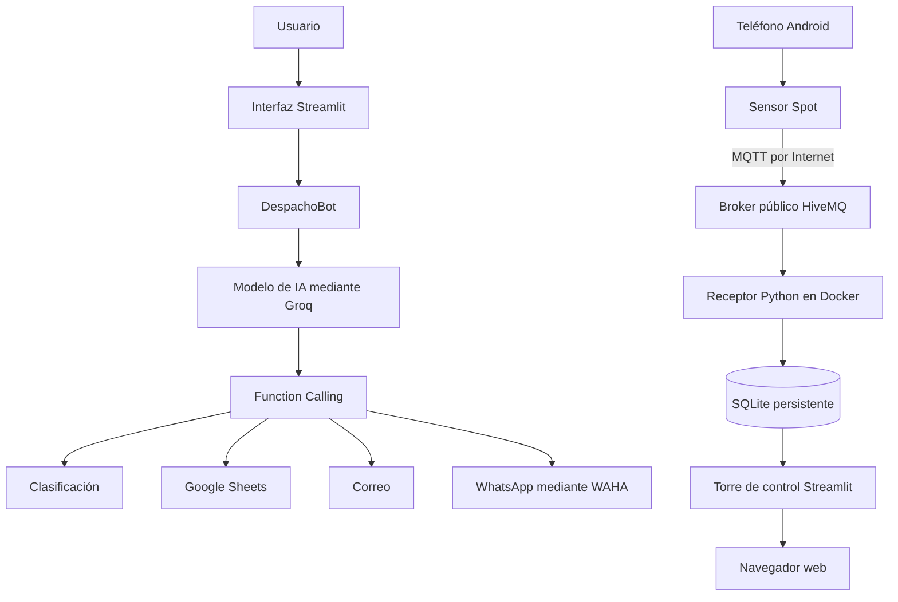

# SysDespacho-IA

Plataforma inteligente para la gestión de despachos y el monitoreo IoT de contenedores.

El sistema combina un asistente con inteligencia artificial, automatización de notificaciones, registro en servicios externos y supervisión de movimiento mediante el acelerómetro de un teléfono Android.

## Funcionalidades principales

### Gestión inteligente de despachos

- Chatbot especializado llamado DespachoBot.
- Procesamiento de lenguaje natural mediante Groq.
- Modelo `openai/gpt-oss-20b`.
- Interfaz web desarrollada con Streamlit.
- Historial de conversación con `st.session_state`.
- Consultas mediante texto y audio.
- Grabación directa desde el micrófono.
- Transcripción mediante Whisper.
- Function Calling con argumentos JSON.

### Clasificación de despachos

Los despachos se clasifican en:

- `A_TIEMPO`: faltan más de 30 minutos.
- `PROXIMO`: faltan entre 0 y 30 minutos.
- `RETRASADO`: la hora programada ya pasó.

### Automatizaciones

El asistente puede ejecutar las siguientes herramientas:

- `clasificar_despacho`
- `registrar_despacho`
- `enviar_alerta_correo`
- `enviar_alerta_whatsapp`
- `procesar_despacho_completo`

Estas funciones permiten:

- Registrar información en Google Sheets.
- Enviar alertas mediante Gmail.
- Enviar mensajes por WhatsApp utilizando WAHA.
- Ejecutar el proceso completo desde una sola solicitud.

### Monitoreo IoT

Un teléfono Android funciona como nodo IoT utilizando su acelerómetro.

La plataforma permite:

- Capturar valores de los ejes X, Y y Z.
- Transmitir lecturas en formato JSON mediante MQTT.
- Recibir mensajes con Python y Paho MQTT.
- Calcular la magnitud y variación del movimiento.
- Almacenar lecturas en SQLite.
- Conservar los datos mediante un volumen Docker.
- Visualizar métricas, alertas y gráficos en Streamlit.

Los estados IoT son:

- `NORMAL`: no se detecta una variación importante.
- `MOVIMIENTO`: se detecta movimiento moderado.
- `IMPACTO`: se detecta un movimiento fuerte o posible golpe.

Los límites utilizados son demostrativos y no representan una calibración industrial.

## Arquitectura general



## Flujo de datos IoT

```text
Acelerómetro
    ↓
Sensor Spot
    ↓
Internet
    ↓
Broker MQTT
    ↓
Receptor Python
    ↓
SQLite
    ↓
Panel Streamlit
```

El teléfono y la computadora pueden utilizar redes diferentes porque ambos se conectan al broker mediante Internet.

El broker transporta los mensajes MQTT, pero no funciona como base de datos. El almacenamiento permanente se realiza en SQLite.

## Formato de las lecturas

Sensor Spot transmite mensajes JSON similares a este:

```json
{
  "type": "android.sensor.accelerometer",
  "values": [-0.08, -0.14, 9.72],
  "timestamp": 2506584219235611
}
```

## Torre de control IoT

El panel empresarial incluye:

- Indicador de riesgo tipo velocímetro.
- Radar de orientación de los ejes X, Y y Z.
- Distribución circular de estados.
- Métricas con tendencias.
- Alertas de movimiento e impacto.
- Análisis de variación.
- Historial de lecturas.
- Identificación del contenedor y ruta.
- Indicador de actualización de telemetría.

## Estructura del proyecto

```text
SysDespacho-IA/
├── .github/
│   └── workflows/
│       └── ci.yml
├── .streamlit/
│   └── config.toml
├── iot_backend/
│   ├── __init__.py
│   ├── almacenamiento.py
│   ├── clasificacion.py
│   └── receptor_mqtt.py
├── iot_frontend/
│   ├── __init__.py
│   ├── dashboard.py
│   └── visualizaciones.py
├── tests/
│   ├── test_funciones.py
│   ├── test_herramientas.py
│   └── test_iot.py
├── app_asistente.py
├── app_audio.py
├── app_consola.py
├── automatizacion.py
├── correo.py
├── funciones.py
├── google_sheets.py
├── herramientas.py
├── streamlit_app.py
├── transcripcion.py
├── whatsapp.py
├── Dockerfile.iot
├── docker-compose.iot.yml
├── requirements.txt
├── .dockerignore
├── .env.example
├── .gitignore
└── README.md
```

## Requisitos

- Python 3.11 o superior.
- Docker Desktop.
- Teléfono Android.
- Sensor Spot.
- Conexión a Internet.
- Cuenta y clave API de Groq.
- Proyecto de Google Cloud con Google Sheets API.
- Cuenta de servicio de Google.
- Cuenta de Gmail con contraseña de aplicación.
- WAHA y una cuenta de WhatsApp autorizada.

## Instalación

Crear el entorno virtual:

```powershell
python -m venv .venv
```

Activarlo:

```powershell
.\.venv\Scripts\Activate.ps1
```

Instalar las dependencias:

```powershell
python -m pip install -r requirements.txt
```

## Variables de entorno

Crear un archivo `.env` tomando como referencia `.env.example`.

Variables principales:

- `GROQ_API_KEY`
- `GROQ_MODEL`
- `GROQ_AUDIO_MODEL`
- `GOOGLE_CREDENTIALS_FILE`
- `GOOGLE_SHEET_ID`
- `GOOGLE_WORKSHEET`
- `SMTP_HOST`
- `SMTP_PORT`
- `SMTP_USER`
- `SMTP_APP_PASSWORD`
- `ALERT_EMAIL_TO`
- `WAHA_URL`
- `WAHA_API_KEY`
- `WAHA_SESSION`
- `WHATSAPP_TO`

Las claves y contraseñas no deben escribirse directamente en el código.

## Ejecución del asistente

Iniciar el contenedor de WAHA cuando se utilicen notificaciones por WhatsApp:

```powershell
docker start waha
```

Iniciar la interfaz principal:

```powershell
python -m streamlit run .\streamlit_app.py
```

Ejecutar el chatbot por consola:

```powershell
python .\app_consola.py
```

Ejecutar el asistente con herramientas:

```powershell
python .\app_asistente.py
```

## Configuración de Sensor Spot

Configurar los siguientes valores:

- Broker: `broker.hivemq.com`
- Puerto: `1883`
- Topic: `sysdespacho/frankarone/ta3/acelerometro`
- QoS: `0`
- Sensor: acelerómetro
- Sensor Sampling Rate: `1000000`
- WebSocket: desactivado
- SSL: desactivado para la demostración

## Ejecución de la plataforma IoT

Construir e iniciar los contenedores:

```powershell
docker compose -f .\docker-compose.iot.yml up --build -d
```

Verificar su estado:

```powershell
docker compose -f .\docker-compose.iot.yml ps
```

Consultar las lecturas recibidas:

```powershell
docker compose -f .\docker-compose.iot.yml logs -f receptor-iot
```

Abrir la torre de control:

```text
http://localhost:8502
```

Detener los servicios sin eliminar los datos:

```powershell
docker compose -f .\docker-compose.iot.yml stop
```

Volver a iniciarlos:

```powershell
docker compose -f .\docker-compose.iot.yml start
```

Las lecturas se conservan en el volumen Docker `datos_iot`.

## Pruebas automatizadas

Ejecutar:

```powershell
python -m pytest -v
```

El proyecto contiene diez pruebas:

- Cuatro pruebas de clasificación de despachos.
- Dos pruebas de herramientas y argumentos JSON.
- Tres pruebas de clasificación IoT.
- Una prueba de almacenamiento SQLite.

## Integración continua

GitHub Actions se ejecuta con cada `push` o `pull request` dirigido a `main`.

El pipeline realiza:

1. Descarga del código.
2. Configuración de Python 3.11.
3. Instalación de dependencias.
4. Ejecución de las diez pruebas.
5. Validación de Docker Compose.
6. Construcción de la imagen IoT.

Una prueba fallida detiene el pipeline y evita que continúen las etapas posteriores.

## Seguridad

Los siguientes archivos y directorios están excluidos mediante `.gitignore` y `.dockerignore`:

- `.env`
- `service_account.json`
- `credentials.json`
- sesiones de WAHA
- entornos virtuales
- bases de datos generadas
- archivos temporales de Python

No deben publicarse:

- claves API;
- contraseñas;
- números personales;
- credenciales de Google;
- sesiones de WhatsApp;
- datos confidenciales.

## Limitaciones

- El broker MQTT es público y compartido.
- La conexión MQTT del ejemplo no utiliza cifrado TLS.
- Sensor Spot debe permanecer abierto durante la transmisión.
- La solución depende de la conexión a Internet.
- Los límites de movimiento requieren calibración para uso real.
- SQLite está orientado a esta implementación y no a una plataforma con miles de dispositivos.
- Las integraciones externas dependen de la disponibilidad de sus respectivos servicios.

Para un entorno real se recomienda utilizar un broker privado con autenticación y TLS, además de una base de datos preparada para un mayor volumen de dispositivos.